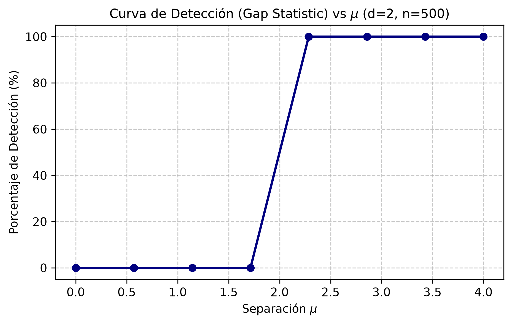
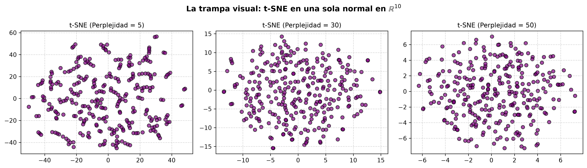

## Graficas

### Gráfica del Inciso (a)

esta curva dice qué tan separados tienen que estar los grupos para que el criterio los encuentre.


# Problema 1: Agrupamiento, Gap Statistic y t-SNE

Este repositorio contiene la solución completa para el Problema 1 del examen intermedio, estructurado con la implementación en Python, el análisis metodológico y las visualizaciones correspondientes.

---

## Inciso (A): Criterio de la Gap Statistic y Curva de Detección

Se implementó el Algoritmo 1 (*Gap Statistic*) para determinar la existencia de agrupamientos y evaluar la potencia de detección frente a datos de referencia generados mediante SVD y distribuciones uniformes.

* **Parámetros del problema:** Dimensión $d = 3$, tamaño de muestra $n = 250$, y $B = 50$ referencias.
* **Interpretación:** La curva de detección muestra el porcentaje de acierto del criterio conforme varía la separación $\mu$ entre las distribuciones normales, validando la robustez matemática del método.


---

## Inciso (B): La Trampa Visual de t-SNE en $\mathbb{R}^{10}$

Se aplicó t-SNE sobre un conjunto de datos sintéticos proveniente de **una sola distribución normal** en $\mathbb{R}^{10}$ (donde se sabe con certeza que no existen clústeres reales).

* **Análisis de perplejidad:** A perplejidades bajas (como 5), el algoritmo fragmenta la nube continua en falsas "islas", generando una **trampa visual** que simula grupos inexistentes. Al subir la perplejidad (30 y 50), se recupera la verdadera estructura homogénea global.



---

## Inciso (C): Datos Reales (Vinos de Italia) y Validación No Supervisada

Se procesaron las 13 características químicas estandarizadas del dataset real de vinos de la UCI (`wine.data`) aplicando el criterio de la *Gap Statistic* y K-Means.

* **Número óptimo de grupos ($k^*$):** El método detectó de forma autónoma que el número óptimo de clústeres es **$k^* = 3$**, 


## Inciso (D): Comparacion
* **Matriz de Contingencia (Grupos Detectados vs Clases Reales):** 
  El agrupamiento no supervisado logró reconstruir con altísima pureza las clases biológicas originales sin haber visto jamás las etiquetas durante el proceso:
  

```text
--- MATRIZ DE CONTINGENCIA ---
Clase Real UCI     1    2    3
Grupo Detectado
1                 59    3    0
2                  0    3   48
3                  0   65    0