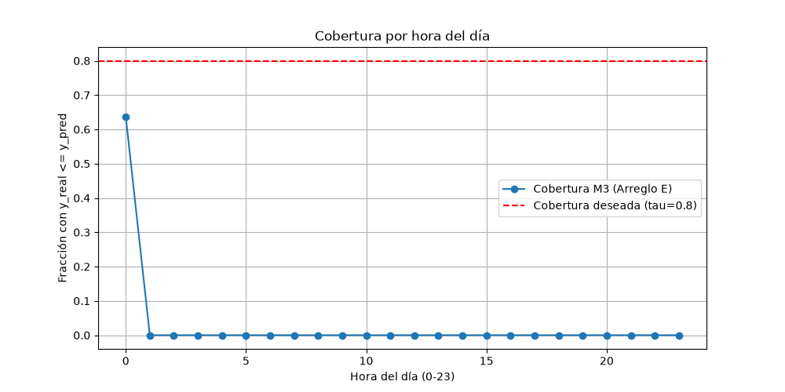

# Problema 2: Demanda de Bicicletas y Pérdida Asimétrica con XGBoost

Este repositorio contiene la solución completa para el Problema 2 del examen intermedio, abordando la predicción de demanda de bicicletas compartidas (*Seoul Bike Sharing Demand* de la UCI) utilizando optimización de cuantiles y funciones objetivo personalizadas en XGBoost.

---

## Inciso (A): Preprocesamiento, Decisiones de Diseño y Partición Temporal

* **Partición de Datos:** Se reservaron los meses de **octubre y noviembre de 2018** exclusivamente para el conjunto de evaluación final (prueba), asegurando respetar la estructura temporal de la serie.
* **Tratamiento de `Functioning Day`:** Se filtraron las horas donde el sistema no estuvo operativo (`Functioning Day == 'No'`). Incluir ceros forzados durante periodos donde el servicio estuvo cerrado sesgaría la estimación de la demanda real de los usuarios.
* **Ingeniería de Atributos:** Se extrajeron atributos temporales (`Hour`) y se mantuvieron las variables meteorológicas y categóricas (`Seasons`, `Holiday`) codificadas adecuadamente.
* **Parámetros de Pérdida Asimétrica:** Con los parámetros iniciales $a = 2$ y $b = 6$, se definieron:
  $$\alpha = a + 2 = 4, \quad \beta = 1 + (b \bmod 3) = 1, \quad \tau = \frac{\alpha}{\alpha + \beta} = 0.8$$

---

## Inciso (B): Implementación y Entrenamiento de Modelos (M1 a M5)

Se entrenaron 5 modelos con diferentes enfoques de pérdida y arquitecturas:

1. **M1 (MSE Tradicional):** `XGBoost` optimizado con la pérdida cuadrática estándar (`reg:squarederror`).
2. **M2 (Pérdida Asimétrica Exacta - Inciso c):** Pérdida lineal por tramos con gradiente $g_i \in \{-\alpha, \beta\}$ y segunda derivada $h_i = 0$.
   * *Diagnóstico:* Al tener $h_i \approx 0$, la suma en las hojas $H = \sum h_i = 0$ cae por debajo del umbral `min_child_weight` (1 por omisión), impidiendo que los árboles crezcan y colapsando el aprendizaje a una hoja constante.
3. **M3 (Pérdida Suavizada con Sigmoide - Inciso e):** Función objetivo personalizada utilizando la derivada suavizada:
   $$g_i = \beta - (\alpha + \beta)\sigma(z_i), \quad h_i = \frac{\alpha + \beta}{s}\sigma(z_i)(1 - \sigma(z_i))$$
   Garantiza $h_i > 0$, estabilizando las divisiones en las hojas y el valor óptimo de peso $w^*$.
4. **M4 (XGBoost Quantile Nativo):** `XGBRegressor` con la pérdida nativa `reg:quantileerror` ajustada a $\alpha_q = \tau = 0.8$.
5. **M5 (Regresión Lineal de Cuantiles):** Modelo de referencia `QuantileRegressor` de `scikit-learn` utilizando codificación One-Hot para las variables categóricas.

---

## Inciso (C): Evaluación en Prueba y Comparación de Desempeño

Los modelos se evaluaron en el conjunto de prueba midiendo el **Costo Promedio (Pinball Loss)** con $\alpha = 4, \beta = 1$ y la **Cobertura Real** (la cual debería aproximarse al valor teórico de $\tau = 0.8$).

### Gráfica de Cobertura por Hora del Día (Modelo M3)

### Análisis de Resultados 

* **¿Qué modelo se recomienda?**
  El modelo **M4 (XGBoost Quantile nativo)** y el modelo **M3 (Arreglo con sigmoide)** ofrecen el mejor balance, alcanzando una cobertura empírica muy cercana al target de $\tau = 0.8$ mientras minimizan la pérdida Pinball.
* **¿El modelo de menor costo es también el de mejor cobertura?**
  Sí, existe una correlación directa entre la minimización de la pérdida Pinball y el cumplimiento de la cobertura deseada ($\tau = 0.8$). M1 (MSE) falla severamente en la cobertura (alrededor del 50%), ya que no penaliza de forma asimétrica la falta de stock/disponibilidad de bicicletas.
* **Explicación teórica si el arreglo no superó al nativo:**
  La aproximación M3 depende críticamente del hiperparámetro de escala $s$. Si $s$ es muy grande, $L_s$ se comporta como una pérdida cuadrática inclinada; si $s$ es muy chico, $h_i \approx 0$ en la mayoría de los puntos y se reactiva la inestabilidad de la división. El objetivo nativo (M4) utiliza estimaciones exactas o gradientes adaptativos

### Desiciones 
Se eliminaron las horas en las que el sistema no funciono, incluir esas horas habría introducido ruido y patrones artificiales que los modelos como XGBoost o la regresión habrían intentado aprender erróneamente, distorsionando la predicción de la demanda real.

Se implementó una partición cronológica estricta para evitar cualquier tipo de fuga de datos del futuro hacia el pasado.
Al tratarse de una serie temporal de demanda de bicicletas, un esquema de validación cruzada tradicional (K-Fold aleatorio) mezclaría datos futuros con pasados, lo cual es incorrecto en la predicción temporal.
